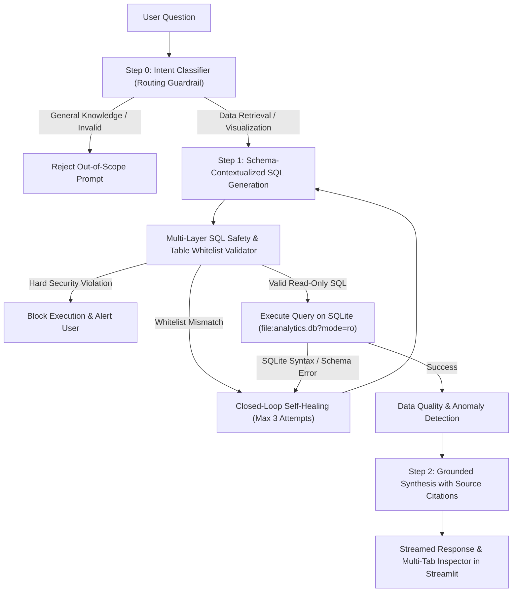

# Live Database Intelligence Assistant

An autonomous Natural Language to SQL (NL2SQL) assistant built with **Streamlit**, **Ollama**, and **SQLite** for the Turku AMK AI Showcase Challenge (Showcase Challenge 2).

The assistant routes user prompts by intent, translates natural language business questions into schema-aware SQLite queries, enforces multi-layer security guardrails, autonomously repairs failed queries via a closed-loop self-healing feedback cycle, audits results for data anomalies, and synthesizes concise answers with explicit source citations.

---

## Key Features

- **Intent Classification (Routing Workflow)**: Categorizes incoming prompts into `Data Retrieval`, `Visualization`, `General Knowledge`, or `Invalid` before invoking database resources, rejecting out-of-scope requests in `<0.5s`.
- **Schema-Aware Text-to-SQL Generation**: Injects full SQLite DDL definitions, foreign-key join paths, and case-insensitive fuzzy matching rules (`LOWER(...) LIKE '%...%'`) into the system prompt.
- **Defense-in-Depth SQL Guardrails**:
  - **Read-Only Statement & Single-Query Enforcement**: Permits only single `SELECT` / `WITH` statements and blocks stacked `;` injections.
  - **Mutating Keyword Blacklist**: Regex validation blocks DDL/DML commands (`UPDATE`, `DELETE`, `ALTER`, `DROP`, `INSERT`, `REPLACE`, `TRUNCATE`, `CREATE`, `ATTACH`, `DETACH`, `PRAGMA`, `VACUUM`).
  - **System Catalog & Table Whitelisting**: Prohibits `sqlite_master` inspection and verifies that queried tables belong to the approved schema (`customers`, `products`, `orders`, `order_items`).
  - **Engine-Level Read-Only URI**: All SQLite connections enforce `file:analytics.db?mode=ro`.
- **Autonomous Self-Healing Feedback Loop (Evaluator-Optimizer Workflow)**: Captures SQLite runtime errors or table-whitelist mismatches, appends the exception context to the conversation history, and re-prompts the LLM to repair the query (up to 3 attempts).
- **Data Anomaly Detection & Grounded Citations**:
  - Scans retrieved records for business-rule anomalies (e.g., negative prices, quantities, or totals).
  - Synthesizes factual 1–2 sentence answers with explicit table and column citations (`[Source: customers table (name), orders table (total_amount)]`) and suggested follow-up questions.
- **Real-Time Thought Streaming & Fast-Mode Early Cutoff**:
  - Supports dual Ollama engines: high-speed deterministic SQL generation (`qwen2.5-coder:7b`) and deep reasoning monologue inspection (`qwen3.5:9b`).
  - Includes a fast-mode heuristic cutoff that halts generation as soon as a complete ````sql ... ```` block is isolated, eliminating post-query rambling.

---

## Architecture & Agent Process Flow



---

## Prerequisites

1. **Python 3.9+**
2. **[Ollama](https://ollama.com/)** installed and running locally
3. Models pulled via Ollama:
   ```bash
   # Fast deterministic SQL coder model (default)
   ollama pull qwen2.5-coder:7b

   # Deep reasoning model with thinking token support
   ollama pull qwen3.5:9b
   ```

---

## Quickstart Guide

### 1. Clone the Repository
```bash
git clone https://github.com/<your-username>/<your-repo-name>.git
cd <your-repo-name>
```

### 2. Set Up a Virtual Environment
```bash
python3 -m venv venv
source venv/bin/activate
```

### 3. Install Dependencies
```bash
pip install -r requirements.txt
```

### 4. Run the Application
```bash
streamlit run app.py
```

Open your browser at `http://localhost:8501`.

---

## Project Structure

```text
├── app.py           # Layered Streamlit application (Config, DB, Guardrails, Agent Pipeline, UI)
├── analytics.db     # SQLite database (customers, products, orders, order_items)
├── requirements.txt # Python dependencies (streamlit, ollama, pandas)
├── .gitignore       # Git exclusion rules
└── README.md        # Project architecture and setup documentation
```
